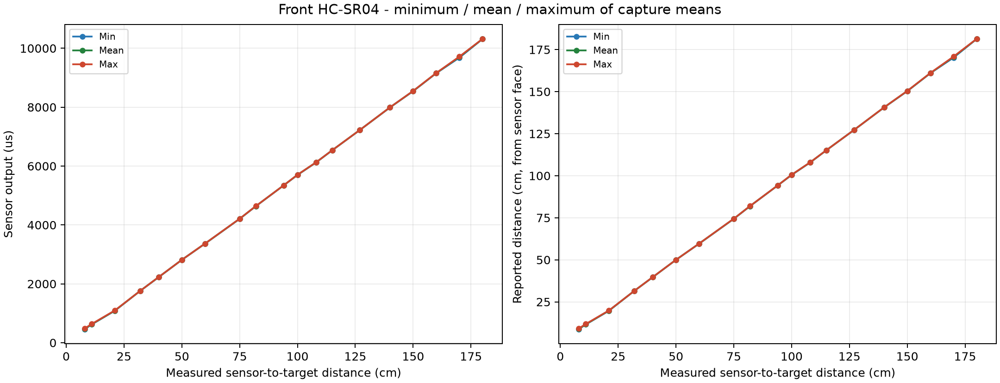

# Front HC-SR04

Samples: 590; capture attempts: 59.
Points with at least three usable accepted captures: 19/19 measured positions (open-ended session).

The horizontal axis uses the entered tape measurement from the sensor face.
Each repetition is a separate capture. The three curves are the minimum, arithmetic mean,
and maximum of accepted capture means at that position, with equal weight per capture.
Sample-level spread is also retained in captures.csv. Missing echoes/ranges are not zero distances.
Skipped, rejected, interrupted and superseded captures remain in samples.csv with inclusion flags.
A point with fewer than three usable captures does not meet the repetition requirement.
Live preview frames stay in the serial log; only explicit DATA captures enter the measurement tables.

[Raw samples](samples.csv) | [Captures](captures.csv) | [Summary](summary.csv)

[Excel workbook with charts](measurements.xlsx)

Ultrasonic conversion: raw_cm = echo_us / 58; calibrated_cm = raw_cm * 1.015350 + 0.709100.
These existing coefficients were obtained over 15-150 cm. Outside that interval their use is extrapolation.
No robot-center mounting offset is added. Raw echo values and uncorrected cm are retained.

This characterizes the tested setup. It does not establish the sensor's entire specified range or absolute accuracy.
Existing calibration constants are preserved; this program does not apply new coefficients.
