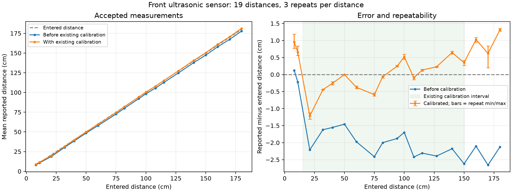

# Ultrasonic measurement review

Completed session: `20261011T142003_780535Z_us`.

19 entered distances, 8-180 cm; 57 accepted five-second captures, 570 accepted samples. All accepted captures have 10/10 valid samples. Sampling timestamp intervals were checked: no gaps outside 490-520 ms. Three usable repeats at every position.

Two additional captures (20 samples) were rejected and are preserved in the raw data. No missing echoes occurred in this completed session. Device status OK alone did not detect the large distance jumps in those rejected captures.

## Existing calibration effect

Errors below compare equally weighted means at each position with the entered tape measurement. They are observed agreement in this setup, not a guaranteed accuracy specification.

| Data | Mean absolute error (cm) | RMS error (cm) | Mean signed error (cm) | Largest absolute error (cm) |
|---|---:|---:|---:|---:|
| All positions, before calibration | 1.893 | 2.010 | -1.880 | 2.657 |
| All positions, existing calibration | 0.512 | 0.636 | 0.192 | 1.311 |
| 15-150 cm, existing calibration | 0.368 | 0.477 | -0.065 | 1.216 |

The largest accepted mean error is +1.31 cm at 180 cm. Within the earlier calibration interval, the largest is -1.22 cm at 21 cm. The maximum spread between the three accepted capture means is 0.64 cm at 170 cm. This spread concerns five-second averages; individual samples vary more (maximum within-capture standard deviation 0.66 cm at 8 cm).

## Rejected captures and incomplete sessions

- At entered 180 cm, rejected capture 1 ranged from 104.98 to 181.48 cm after conversion.
- At entered 160 cm, rejected capture 8 ranged from 98.01 to 161.61 cm after conversion.
- These large jumps are compatible with transient setup changes or unwanted echoes, but the logs cannot identify their cause. Retain rejection flags in any presentation.
- Earlier session `20261011T134101_190940Z_us` is incomplete: its 200 cm attempt had no echoes; its single accepted capture labelled 180 cm read 65.18 cm. Keep it separate from the completed run; do not silently merge it.
- Laser session `20261011T144040_475227Z_laser` had only a connection event at review time; no recorded measurements yet. No IR session was present.

## Coverage and next steps

The completed run supports characterization over the measured 8-180 cm interval. There is no completed 200 cm position, nor any test of the full specified sensor range. The 8, 11, 160, 170 and 180 cm results extrapolate the previous 15-150 cm calibration. Keep the existing calibration for the next sensor tests; these results do not suggest a need to replace it. If completing the original 2 m endpoint matters, add 200 cm with three repeats. Independent target placements or another run are needed to assess reproducibility beyond these same-position repeats. No new calibration was fitted or applied.

| Entered cm | Raw echo mean (us) | Uncorrected cm | Existing calibration cm | Error cm | Repeat mean span cm |
|---:|---:|---:|---:|---:|---:|
| 8 | 471.07 | 8.12 | 8.96 | +0.96 | 0.417 |
| 11 | 625.27 | 10.78 | 11.66 | +0.66 | 0.280 |
| 21 | 1089.63 | 18.79 | 19.78 | -1.22 | 0.198 |
| 32 | 1762.00 | 30.38 | 31.55 | -0.45 | 0.004 |
| 40 | 2229.90 | 38.45 | 39.75 | -0.25 | 0.095 |
| 50 | 2815.50 | 48.54 | 50.00 | -0.00 | 0.004 |
| 60 | 3365.50 | 58.03 | 59.63 | -0.37 | 0.079 |
| 75 | 4210.03 | 72.59 | 74.41 | -0.59 | 0.095 |
| 82 | 4640.07 | 80.00 | 81.94 | -0.06 | 0.068 |
| 94 | 5343.03 | 92.12 | 94.24 | +0.24 | 0.044 |
| 100 | 5701.47 | 98.30 | 100.52 | +0.52 | 0.144 |
| 108 | 6123.53 | 105.58 | 107.91 | -0.09 | 0.088 |
| 115 | 6536.20 | 112.69 | 115.13 | +0.13 | 0.054 |
| 127 | 7227.17 | 124.61 | 127.23 | +0.23 | 0.025 |
| 140 | 7993.67 | 137.82 | 140.65 | +0.65 | 0.079 |
| 150 | 8547.97 | 147.38 | 150.35 | +0.35 | 0.145 |
| 160 | 9158.03 | 157.90 | 161.03 | +1.03 | 0.140 |
| 170 | 9705.90 | 167.34 | 170.62 | +0.62 | 0.639 |
| 180 | 10316.57 | 177.87 | 181.31 | +1.31 | 0.077 |

[Existing workbook](measurements.xlsx) | [Capture data](captures.csv) | [All raw samples with inclusion flags](samples.csv)
