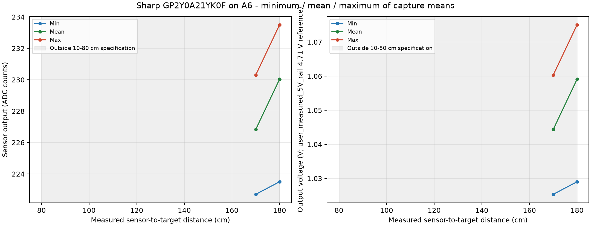

# Sharp GP2Y0A21YK0F on A6

Samples: 60; capture attempts: 6.
Points with at least three usable accepted captures: 2/2 measured positions (open-ended session).

The horizontal axis uses the entered tape measurement from the sensor face.
Each repetition is a separate capture. The three curves are the minimum, arithmetic mean,
and maximum of accepted capture means at that position, with equal weight per capture.
Sample-level spread is also retained in captures.csv. Missing echoes/ranges are not zero distances.
Skipped, rejected, interrupted and superseded captures remain in samples.csv with inclusion flags.
A point with fewer than three usable captures does not meet the repetition requirement.
Live preview frames stay in the serial log; only explicit DATA captures enter the measurement tables.

[Raw samples](samples.csv) | [Captures](captures.csv) | [Summary](summary.csv)

[Excel workbook with charts](measurements.xlsx)

The Sharp GP2Y0A21YK0F specification covers 10-80 cm. Farther points are exploratory ADC observations.
There is no measured IR distance calibration in the project; no generic inverse-distance formula is applied.
Volts = ADC * 4.71 / 1023; reference source: user_measured_5V_rail.

This characterizes the tested setup. It does not establish the sensor's entire specified range or absolute accuracy.
Existing calibration constants are preserved; this program does not apply new coefficients.
