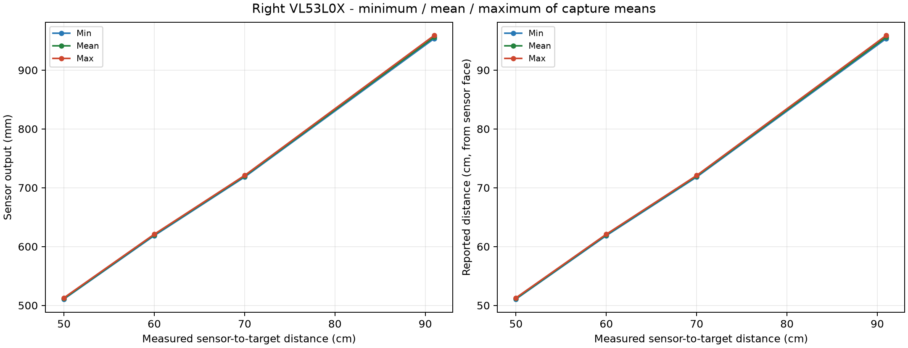

# Right VL53L0X

Samples: 120; capture attempts: 12.
Points with at least three usable accepted captures: 4/4 measured positions (open-ended session).

The horizontal axis uses the entered tape measurement from the sensor face.
Each repetition is a separate capture. The three curves are the minimum, arithmetic mean,
and maximum of accepted capture means at that position, with equal weight per capture.
Sample-level spread is also retained in captures.csv. Missing echoes/ranges are not zero distances.
Skipped, rejected, interrupted and superseded captures remain in samples.csv with inclusion flags.
A point with fewer than three usable captures does not meet the repetition requirement.
Live preview frames stay in the serial log; only explicit DATA captures enter the measurement tables.

[Raw samples](samples.csv) | [Captures](captures.csv) | [Summary](summary.csv)

[Excel workbook with charts](measurements.xlsx)

Recorded laser profile: long_range_33ms_single_shot. Output is mm; there is no extra empirical laser correction.
Successful device status 11 is required. The library does not implement ST's full host sigma validation.
The 2 m endpoint is an exploration of actual range; target reflectance, lighting and profile affect success.

This characterizes the tested setup. It does not establish the sensor's entire specified range or absolute accuracy.
Existing calibration constants are preserved; this program does not apply new coefficients.
