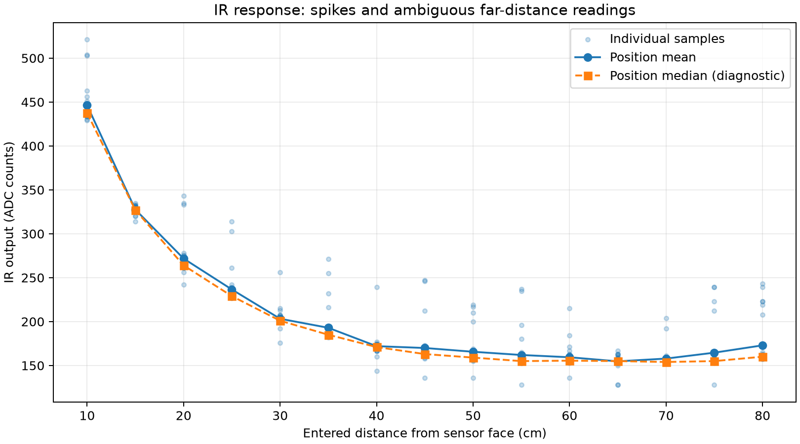

# IR and laser follow-up review

IR source: `20261011T152446_019469Z_ir`. Completed 15 positions (10-80 cm), three captures per position, 450 accepted ADC samples. All reported status OK; for this analog sensor that does not establish valid distance. Reference recorded as 4.71 V.

The mean IR response decreases to 65 cm, then rises. At 40 cm the mean is 172.00 counts; at 80 cm it is 172.93 counts. These readings cannot uniquely identify a distance. Sample medians flatten around 154-160 counts over 50-80 cm, so suppressing spikes alone does not restore useful sensitivity over the full interval. Individual samples contain substantial excursions; for example 40 cm spans 144-239 counts.

The near-distance response is more distinguishable, especially 10-30 cm, but is not independently validated for distance conversion. No automatic ADC-to-cm calibration was fitted or enabled. Preserve raw readings and voltage for the assignment characteristic; an output curve remains useful even when inversion is ambiguous.

Recommended checks: repeat 20, 40, 60 and 80 cm using a large matte target perpendicular to the sensor, a fixed mount and unchanged lighting. Confirm actual distances start at the IR sensor face. Inspect the sensor supply and local bypass capacitor before a new calibration. These are possible diagnostic controls, not a diagnosis of the cause.

| Distance cm | Mean ADC | Median ADC | Mean V | Sample min ADC | Sample max ADC |
|---:|---:|---:|---:|---:|---:|
| 10 | 446.33 | 437.5 | 2.055 | 429 | 521 |
| 15 | 327.53 | 327.0 | 1.508 | 314 | 335 |
| 20 | 271.77 | 264.0 | 1.251 | 242 | 343 |
| 25 | 236.57 | 229.0 | 1.089 | 227 | 314 |
| 30 | 203.23 | 201.0 | 0.936 | 176 | 256 |
| 35 | 192.93 | 185.0 | 0.888 | 182 | 271 |
| 40 | 172.00 | 171.0 | 0.792 | 144 | 239 |
| 45 | 169.93 | 163.0 | 0.782 | 136 | 247 |
| 50 | 165.63 | 159.0 | 0.763 | 136 | 219 |
| 55 | 161.97 | 155.0 | 0.746 | 128 | 237 |
| 60 | 159.37 | 155.5 | 0.734 | 136 | 215 |
| 65 | 154.73 | 155.0 | 0.712 | 128 | 167 |
| 70 | 157.87 | 154.0 | 0.727 | 152 | 204 |
| 75 | 164.60 | 155.0 | 0.758 | 128 | 239 |
| 80 | 172.93 | 160.0 | 0.796 | 157 | 243 |

## Laser alignment follow-up

New session `20261011T152053_543501Z_laser` contains 50, 60, 70 and 91 cm, three repeats each, 120 accepted samples. All device statuses are OK.

| Entered cm | Earlier reported mean cm | New reported mean cm | Change cm |
|---:|---:|---:|---:|
| 50 | 51.407 | 51.173 | -0.233 |
| 60 | 62.297 | 62.010 | -0.287 |
| 70 | 71.900 | 71.977 | +0.077 |
| 91 | No exact matching position | 95.623 | - |

The three common positions agree within 0.29 cm. This does not show a clear discontinuity at 60 cm, nor establish that every earlier tilted measurement is unaffected. Positive errors remain: +1.17 cm at 50, +2.01 cm at 60, +1.98 cm at 70, and +4.62 cm at 91. Keep the alignment note; do not overwrite the earlier source measurements.

[IR workbook](measurements.xlsx) | [IR raw samples](samples.csv)
