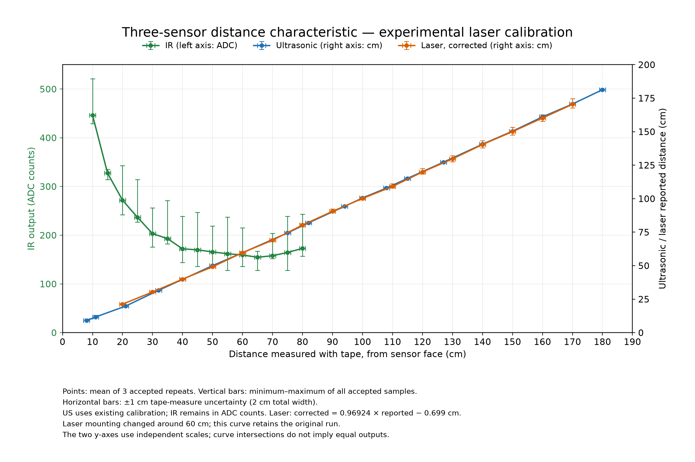

# Three-sensor comparison



[PDF](three-sensor-characteristic.pdf) | [SVG](three-sensor-characteristic.svg) | [Plotted values](plotted-data.csv)

Shared x-axis: entered distance from the sensor face. IR uses the left ADC axis; ultrasonic and laser use the right cm axis. The three colors identify the sensors. Each point is the equally weighted mean of three accepted repeat means. Vertical bars span the minimum and maximum individual valid samples across those repeats; they are not standard deviations or confidence intervals. Horizontal bars are ±1 cm (2 cm total width), the assumed tape-measure uncertainty.

One completed principal session per sensor is used: 19 ultrasonic positions, 16 laser positions, 15 IR positions; 1,500 accepted samples total. Rejected and incomplete attempts and separate laser follow-up measurements are not mixed into these curves. The laser's reported mounting adjustment around 60 cm remains a limitation of its original run. Ultrasonic values include the existing calibration; laser values use the experimental empirical correction below. No IR distance conversion is applied. Lines connect measured points only and do not establish response outside the tested distances. Independent y-axis scales mean visual intersections do not indicate equal sensor readings.

Reproduce from the last_chance folder:

```powershell
.\.venv\Scripts\python.exe tools\distance_test\plot_comparison.py --calibrated-laser
```

Input hashes are in sources-sha256.json; archived source files remain unchanged.

## Experimental laser correction

`corrected_cm = 0.969241451 * reported_cm -0.699266228`

Fit by ordinary least squares to the 16 position means of the original 20-170 cm laser run, with equal weight per position. This includes the reported mounting change near 60 cm, so treat the result as an experimental correction for this dataset. It has not been applied to firmware.

Training mean absolute error: 3.736 cm before, 0.451 cm after. These same-data residuals do not establish independent accuracy.

The separate follow-up positions (50, 60, 70, 91 cm) were not used in fitting. Their mean absolute error is 2.446 cm before and 0.904 cm after. This is a limited consistency check with the same tape reference, not validation over the full range.

Vertical bars transform every accepted sample using the same positive scale and offset. They show sample range only; they exclude uncertainty in the fitted coefficients. Horizontal bars remain ±1 cm. Coefficients, source sessions and per-position residuals are in laser-calibration.json.
