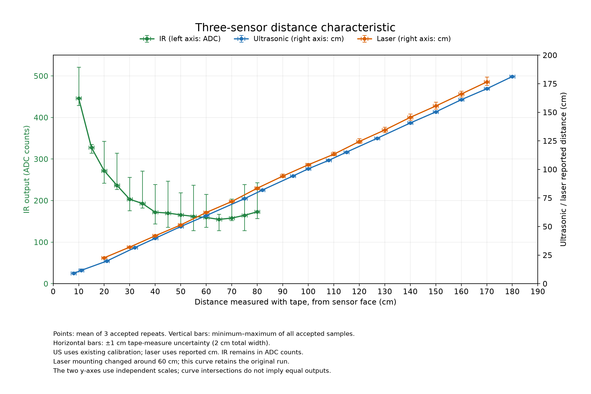

# Three-sensor comparison



[PDF](three-sensor-characteristic.pdf) | [SVG](three-sensor-characteristic.svg) | [Plotted values](plotted-data.csv)

Shared x-axis: entered distance from the sensor face. IR uses the left ADC axis; ultrasonic and laser use the right cm axis. The three colors identify the sensors. Each point is the equally weighted mean of three accepted repeat means. Vertical bars span the minimum and maximum individual valid samples across those repeats; they are not standard deviations or confidence intervals. Horizontal bars are ±1 cm (2 cm total width), the assumed tape-measure uncertainty.

One completed principal session per sensor is used: 19 ultrasonic positions, 16 laser positions, 15 IR positions; 1,500 accepted samples total. Rejected and incomplete attempts and separate laser follow-up measurements are not mixed into these curves. The laser's reported mounting adjustment around 60 cm remains a limitation of its original run. Ultrasonic values include the existing calibration; laser mm are converted to cm without an empirical correction. No IR distance conversion is applied. Lines connect measured points only and do not establish response outside the tested distances. Independent y-axis scales mean visual intersections do not indicate equal sensor readings.

Reproduce from the last_chance folder:

```powershell
.\.venv\Scripts\python.exe tools\distance_test\plot_comparison.py
```

Input hashes are in sources-sha256.json; archived source files remain unchanged.
