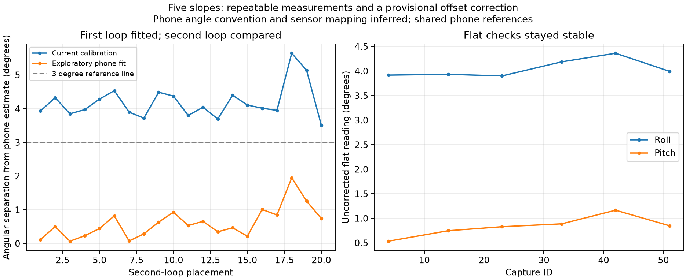

# Five-slope experiment review

All 40 planned slope placements were accepted, and the run completed. The active firmware used the replacement sensor six-face calibration with its validation skipped by user instruction. No new calibration has been applied during this analysis.

The user confirmed S5 phone heading 270 was `0 -34`, correcting an omitted minus sign. An appended correction/reference block preserves the original entry and all original serial/sample logs.

## Stability

All 20 first/second-loop pairs differ by less than 3 degrees on each axis. The largest paired difference is 2.69 degrees (S5 pitch). Start-to-end flat drift is 0.067 degrees roll and 0.304 degrees pitch. The average initial flat capture group was 3.92 degrees roll / 0.53 degrees pitch; final flat was 3.995 / 0.85 degrees. No substantial flat changes were detected.

## Slopes

The robot estimate below averages half-differences of opposite headings in both loops to cancel a constant angle offset approximately. It is descriptive and does not use the fitted candidate.

| Surface | Phone estimate (degrees) | Robot opposite-heading estimate (degrees) | Largest loop difference on either axis (degrees) |
| --- | ---: | ---: | ---: |
| S1 | 4.3 | 4.1 | 0.36 |
| S2 | 8.8 | 8.5 | 0.14 |
| S3 | 14.0 | 13.9 | 0.72 |
| S4 | 20.0 | 19.9 | 0.50 |
| S5 | 34.3 | 33.7 | 2.69 |

## Exploratory calibration fit

Analysis assumes phone readings are independent axis elevations with positive readings meaning the named phone edge is high. The signed sensor map `x,-y,z` was inferred from the consistent heading response; neither it nor the phone convention has been physically verified. The mostly single-axis slopes do not strongly distinguish phone angle conventions. All numeric comparisons below are conditional on these assumptions.

Only loop 1 (20 placements) was used to fit normalized ADC offset/scale constants. Loop 2 (20 placements) was reserved for comparison. The Z range was insufficient for a reliable new Z scale, so both Z constants remain at their current firmware values. The fitted offsets may absorb sensor mounting/chassis offset; this is an installed-system proposal.

- Second-loop angular RMS versus phone: 4.21 degrees current, 0.75 degrees proposed.
- Second-loop maximum angular separation: 5.64 degrees current, 1.95 degrees proposed.
- Proposed results within +/-3 degrees on both axes: 20/20 second-loop placements.

Both loops share the same phone reference for each surface. No after-run phone blocks were taken, and there is no new independent surface validation. These figures establish conditional agreement and repeatability, not absolute accuracy. The inferred mapping prevents this proposal from being marked recommended for application.

Full details: [report](report.txt), [proposed constants](calibration-proposal.json), [placement measurements](placements.csv), [all 25,500 samples](samples.csv).

The sample CSV includes all 51 capture attempts, including repeats, with raw
X/Y/Z and supply-reference ADC counts, acceleration in g, angles, timestamps,
trial IDs and inclusion status. It is copied unchanged from the completed analysis;
it uses the acquisition calibration, not the proposed phone-based fit.
